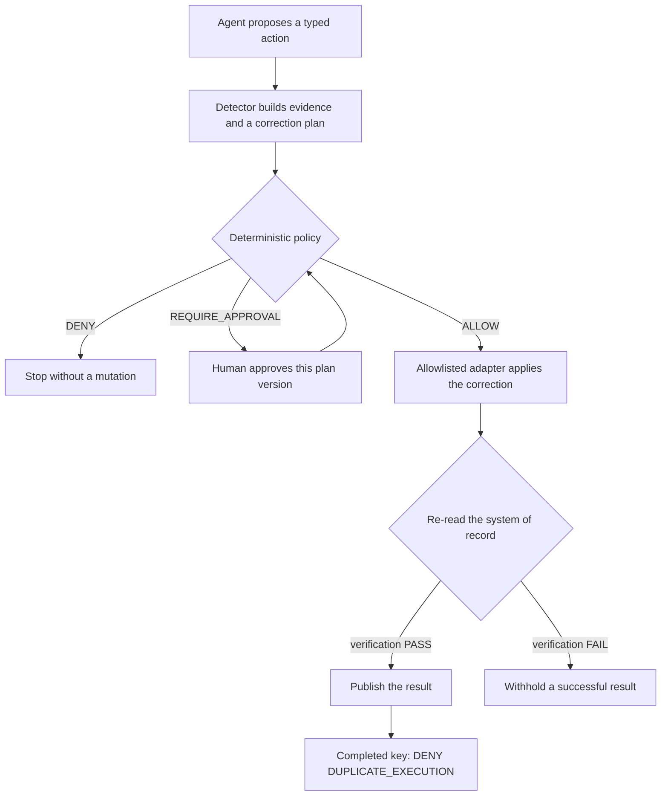
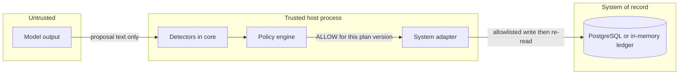

# LedgerGuard

[](https://github.com/Val1-IT/Arvanta-Ledgerguard/actions/workflows/ci.yml)
[](LICENSE)
[](https://github.com/Val1-IT/Arvanta-Ledgerguard/releases/latest)

**Deterministic approval and verify-before-commit for AI agents that act on systems of record.**

An agent may inspect a ledger, explain what it found, and propose a typed repair. It does not receive the right to post, void, or reverse a record because a model emitted a tool call. LedgerGuard decides `ALLOW`, `DENY`, or `REQUIRE_APPROVAL` in ordinary code, binds approval to one plan version, and treats the write as successful only after the system of record is read back and the postconditions pass.

Status: **v0.3.0**. The offline demos run on synthetic data in memory. PostgreSQL is the transactional reference adapter. Odoo 19 is an experimental adapter for one constrained inventory action, not a general ERP product. License: [Apache-2.0](LICENSE).

A recorded run of the commands below is in the [case study](docs/case-study.md): an agent reversing a duplicated invoice line denominated in IDR.

## The problem

Systems of record such as an ERP keep the numbers a business will not get back easily: posted invoices, inventory receipts, journal balances. A duplicated invoice line or a doubled goods receipt changes what a customer owes and what stock is worth. The screen shows a total. It does not show which posting is the extra one, or stop a second write.

An AI agent asked to "fix the books" will eventually call a mutation tool. If that call is the authority, the agent can reverse the genuine line, apply the same reversal twice, or report success because an API returned. Those writes are irreversible in the practical sense: the undo is another mutation, with its own chance to make the ledger worse.

LedgerGuard is the control in front of that write.

## How it works

1. **Propose.** A deterministic detector, not the model, builds evidence, a typed correction, a financial impact, and the postconditions that must hold afterward. The agent does not send SQL.
2. **Decide.** `@ledgerguard/policy` returns `ALLOW`, `DENY`, or `REQUIRE_APPROVAL`. Execution needs an approval of that exact plan version. Missing evidence, missing verification rules, a missing capability, a stale plan version, or a completed idempotency key are denials. When the impact is above the configured threshold, the decision also records `IMPACT_THRESHOLD_EXCEEDED` until that approval exists. `assertTrustedApprover` rejects `actorType: "agent"`.
3. **Approve.** A human (or another trusted non-agent actor supplied by the host) approves one plan version. The demo simulates that approval in process. The model cannot mint `trusted_runtime` authority.
4. **Execute and verify.** The adapter applies an allowlisted correction. On the inventory and PostgreSQL path, `executeConstrainedRemediation` re-reads state inside `runInTransaction` and returns `committed: true` only when verification is `PASS`. The PostgreSQL adapter issues `COMMIT` only after that callback returns, and `ROLLBACK` if it throws. The custom-action path (`executeConstrainedAction`) checks a fingerprint, applies the action, then verifies and reports `VERIFIED` or `VERIFICATION_FAILED`.
5. **Refuse the replay.** A second attempt against the approved fingerprint is stale and does not mutate. A completed idempotency key is policy `DENY` with `DUPLICATE_EXECUTION`.



The diagram matches `executeConstrainedRemediation`: the in-memory inventory adapter replaces its snapshot only after the transaction callback returns, and the PostgreSQL adapter commits only after that same callback returns. The invoice example in the case study uses `executeConstrainedAction`, which reports verification after the in-memory write.

## Quickstart

Requires Node.js 24, or 20.19+ / 22.12+, and pnpm 9.15.9 (`packageManager` in `package.json`). No Docker, database, `.env`, or model API key.

```bash
git clone https://github.com/Val1-IT/Arvanta-Ledgerguard.git
cd Arvanta-Ledgerguard
pnpm install --frozen-lockfile
pnpm demo
pnpm example:quickstart
pnpm verify
```

`pnpm demo` installs `tsx`, `decimal.js`, and `zod` into `examples/inventory-ledger`, then runs the duplicate-inventory scenario. The first install needs the npm registry. Pass `--quiet` to keep the summary. The scenario exits nonzero when an expected result fails.

`pnpm demo` ends with:

```text
DEMO PASS: duplicate detected; approval required; repair verified.
Quantity: 20.000 -> 10.000 | Valuation: 1700000.00 -> 850000.00
Replay: DRIFT_DETECTED | Completed-key policy: DENY (DUPLICATE_EXECUTION)
In-memory demonstration only; persisted idempotency and SQL transactions need the PostgreSQL integration path.

---------- DEMO SUMMARY ----------
Result: DEMO PASS
Incident: DUPLICATE_INVENTORY_MOVEMENT
Policy: REQUIRE_APPROVAL → ALLOW (simulated human approval of plan v2)
Execute: committed, verification PASS
Replay: DRIFT_DETECTED | Completed-key policy: DENY (DUPLICATE_EXECUTION)
Quantity: 20.000 → 10.000 | Valuation: 1700000.00 → 850000.00
----------------------------------
```

`pnpm example:quickstart` is the invoice-line lifecycle in [examples/custom-action/src/agent-quickstart.ts](examples/custom-action/src/agent-quickstart.ts). A successful run prints:

```text
{
  beforeApproval: 'REQUIRE_APPROVAL',
  afterApproval: 'ALLOW',
  execution: 'VERIFIED',
  retry: 'DENY'
}
```

`pnpm verify` is typecheck, lint, and unit tests. It does not need PostgreSQL. `pnpm scenario:custom-action:memory` prints the full invoice walkthrough used in the [case study](docs/case-study.md).

In containers, `corepack enable` can fail until `COREPACK_HOME` is writable (`export COREPACK_HOME=/tmp/corepack`). pnpm 10 is untested.

### PostgreSQL demo

Optional. Use a local PostgreSQL 16 instance and a new empty database whose name starts with `ledgerguard_demo_`. The demo accepts only explicit loopback URLs with that name prefix and no query string or fragment. Setup, prompts, and safety limits: [docs/testing/postgres-demo.md](docs/testing/postgres-demo.md).

```bash
createdb --host=127.0.0.1 --port=5432 --username=YOUR_LOCAL_ROLE --template=template0 ledgerguard_demo_first_run
export DATABASE_URL='postgresql://YOUR_LOCAL_ROLE@127.0.0.1:5432/ledgerguard_demo_first_run'
pnpm demo:pg
```

Integration tests need a separate disposable database and a role with `CREATEDB`. Do not point them at data you keep:

```bash
pnpm verify:integration
```

## Architecture

| Package | Role |
| --- | --- |
| `@ledgerguard/core` | Investigation, evidence, effects, verification, execution contracts |
| `@ledgerguard/policy` | `ALLOW` / `DENY` / `REQUIRE_APPROVAL`, trusted authority, approval, audit primitives |
| `@ledgerguard/postgres` | Allowlisted SQL mutations; `BEGIN`, verify inside the transaction, then `COMMIT` |
| `@ledgerguard/odoo` | Experimental single inventory adjustment |
| `@ledgerguard/datahub` | Optional catalog context and metadata write-back. Not authority |

The Next.js app under `app/` is a demo shell. It is not the runtime.



Authority has to be built by the host with `trustedRuntimeAuthority`. Parsed authority accepts `source: "trusted_runtime"` only. Detail: [authority model](docs/architecture/authority-model.md), [execution integrity](docs/architecture/execution-integrity.md), [threat model](docs/threat-model.md).

Two detectors ship in this version.

- **Duplicate inventory movement.** Receipt `RCP-001` is 10 units. Movements `MOV-001` and `MOV-002` each post +10. The repair reverses `MOV-002` only. The quickstart prints quantity `20.000` to `10.000` and valuation `1700000.00` to `850000.00`.
- **Duplicate invoice line** (custom-action example). Invoice `INV-1001` carries two active lines for one event. The repair reverses the later line and restores the invoice total from `1000000.00` to `500000.00`. Walkthrough: [docs/case-study.md](docs/case-study.md).

A unit-conversion scenario (a carton factor of 12 recorded as 10) is implemented in the engine and traced with `decimal.js`. It is not the offline `pnpm demo` path.

## Where an agent plugs in

The agent produces a snapshot or a typed action. LedgerGuard decides. The short form is `pnpm example:quickstart`. The same lifecycle, with the policy call written out, is in [examples/inventory-ledger/README.md](examples/inventory-ledger/README.md). To point the Postgres adapter at a table you own, see [docs/try-on-your-own-table.md](docs/try-on-your-own-table.md) and the [adoption tutorial](docs/integrations/adoption-tutorial.md).

## Why this matters

A posted invoice or a goods receipt is a balance other entries depend on. The model may narrate. Deterministic code authorizes. A recorded approval covers one plan version. Success means the ledger was read back. That split is what stands between an agent and an unsupervised write.

The case study is the small version of that split. Before approval the invoice plan is `REQUIRE_APPROVAL`. After a simulated human approval it is `ALLOW`, the repair verifies, and the same key is `DENY`. The duplicate receipt in `pnpm demo` does the same thing and withholds commit on a drifted replay (`DRIFT_DETECTED`, `committed: false`).

## Limitations

- **Demo authority.** The demos and the sample UI mint capabilities in process. There is no production authentication. A compromised host that can construct `trustedRuntimeAuthority` can approve.
- **Simulated approval.** `pnpm demo` and the invoice scenario print `Simulating human approval`. That is a fixed fixture, not a person at a keyboard.
- **In-memory is not a database.** Those runs do not persist idempotency keys and do not issue SQL. Persisted replay (`ALREADY_EXECUTED`) and SQL rollback belong to the PostgreSQL path, which this README's recorded run did not execute.
- **Two execution shapes.** Inventory remediation verifies inside the transaction callback and publishes state only when verification passes. `executeConstrainedAction` (the invoice example) verifies after `execute`. A failed check returns `VERIFICATION_FAILED` with `mutated: true`. This repository does not claim that path rolls back a remote write by itself.
- **Not exactly-once.** PostgreSQL same-database atomicity closes the post-commit reserved-key window for that adapter. Other adapters, and expired reservations whose live state is ambiguous (`RECOVERY_REQUIRED`), are not exactly-once.
- **Narrow detectors.** Duplicate inventory, the invoice example, and the conversion-mismatch engine are specific incidents. LedgerGuard does not detect arbitrary ERP failures. When both built-in inventory incidents exist, conversion mismatch takes precedence.
- **Odoo.** Experimental and opt-in: one `stock.quant` adjustment. See [docs/integrations/odoo.md](docs/integrations/odoo.md). Live Odoo tests skip when no live config is present.
- **Journals.** Evidence may list journal rows. `RECONCILE_JOURNAL_ENTRIES` is not a correction target. This is not a general journal-posting or journal-editing product.
- **Not an auditor.** The runtime does not replace accounting review, and it is not a migration tool.

## Development

```bash
pnpm verify                 # typecheck, lint, unit tests
pnpm verify:integration     # migrate + Postgres integration tests
pnpm test:datahub           # optional; needs live DataHub
```

[CONTRIBUTING.md](CONTRIBUTING.md). Security reports: [SECURITY.md](SECURITY.md).

Independent evaluation: [external tester guide](docs/testing/external-tester-guide.md). Historical hackathon drafts: [docs/archive/hackathon/](docs/archive/hackathon/).

The shipped web UI is a private synthetic-data evaluation app. Published compose ports bind to loopback. Do not expose the UI or load real customer data without a separate identity, authorization, ingress, backup, and migration review. See [deployment validation](docs/testing/deployment-validation.md).
