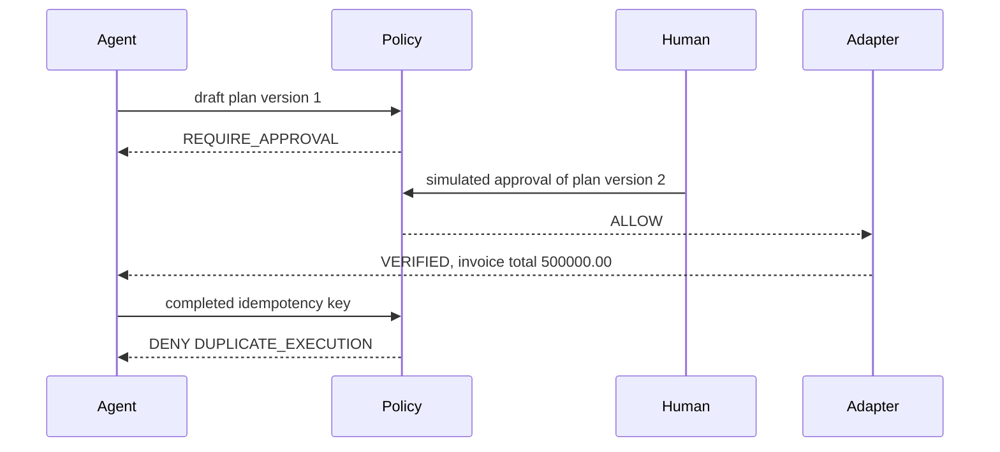

# Case study: an agent reverses a duplicated invoice line

This is a recorded run of the repository, not a production incident. The books are the synthetic IDR fixture in [examples/custom-action/src/demo.ts](../examples/custom-action/src/demo.ts): one invoice, two active lines, one shared event identity. The shape is the irreversible accounting action an agent would take in an SME ledger — void the extra posted line and change the invoice total — using the data this repo actually executes.

Nothing below is a measured customer result. Figures appear only when a command printed them, or when they are the fixture constants that command loads.

## Environment

| Item | Value |
| --- | --- |
| Date | 2026-11-12 (UTC) |
| Node.js | v22.23.4 |
| pnpm | 9.15.9 |
| Commands | `pnpm install --frozen-lockfile`, `pnpm demo`, `pnpm demo --quiet`, `pnpm example:quickstart`, `pnpm scenario:custom-action:memory`, `pnpm test`, `pnpm verify` |
| Not run | `pnpm demo:pg`, `pnpm verify:integration`. No PostgreSQL client was used. No live Odoo config was set. |

`pnpm install --frozen-lockfile` exited 0. `pnpm test` and `pnpm verify` exited 0. `pnpm verify` reported `No ESLint warnings or errors` and then the same unit tests as `pnpm test`. Vitest summaries from `pnpm test`:

```text
workspace:     Test Files  46 passed (46)   Tests  275 passed (275)
@ledgerguard/core:      Test Files  16 passed (16)   Tests  59 passed (59)
@ledgerguard/postgres:  Test Files  4 passed (4)     Tests  81 passed (81)
@ledgerguard/odoo:      Test Files  7 passed | 2 skipped (9)   Tests  47 passed | 8 skipped (55)
@ledgerguard/datahub:   Test Files  3 passed (3)     Tests  6 passed (6)
@ledgerguard/policy:    Test Files  4 passed (4)     Tests  15 passed (15)
```

The skipped Odoo tests are the live JSON-2 suites guarded by `describe.skipIf(!config)`.

## The fixture the invoice command loads

`scenario()` in `examples/custom-action/src/demo.ts` builds:

| Record | Fields loaded by the demo |
| --- | --- |
| Invoice `INV-1001` | `total` `1000000.00` |
| `LINE-001` | SKU `WIDGET-A`, amount `500000.00`, event `invoice:INV-1001:WIDGET-A`, posted `2026-04-01T10:00:00.000Z`, `reversedAt` null |
| `LINE-002` | same SKU, amount, and event, posted `2026-04-01T10:00:00.250Z`, `reversedAt` null |

Currency in that file is `IDR`. The approval threshold constant is `1000`. The detector groups active lines by `eventIdentity`, invoice id, SKU, and amount. The earliest line is treated as legitimate. The later line is the duplicate. The proposed action type is `REVERSE_DUPLICATE_INVOICE_LINE`.

The proposed repair is a void of posted line `LINE-002` plus a change to the invoice total. The passing run left `LINE-001` in place and refused a second application.

## What the run printed

Command:

```bash
pnpm scenario:custom-action:memory
```

Exit code 0. Program output:

```text
LedgerGuard custom-action example: synthetic in-memory invoice data; no database or API keys.

=== Incident ===
DUPLICATE_INVOICE_LINE

=== Evidence ===
[
  {
    "table": "invoice_lines",
    "recordId": "LINE-001",
    "field": "amount",
    "reason": "Earliest matching line is the legitimate posting"
  },
  {
    "table": "invoice_lines",
    "recordId": "LINE-002",
    "field": "eventIdentity",
    "reason": "Later line repeats invoice, sku, amount, and event identity"
  },
  {
    "table": "invoices",
    "recordId": "INV-1001",
    "field": "total",
    "reason": "Invoice total includes the duplicated line"
  }
]

=== Proposed repair ===
[
  {
    "sequence": 1,
    "table": "invoice_lines",
    "recordId": "LINE-002",
    "field": "reversed_at",
    "beforeValue": "null",
    "afterValue": "2026-04-01T10:00:00.250Z"
  },
  {
    "sequence": 2,
    "table": "invoices",
    "recordId": "INV-1001",
    "field": "total",
    "beforeValue": "1000000.00",
    "afterValue": "500000.00"
  }
]

=== Policy before approval ===
{
  "outcome": "REQUIRE_APPROVAL",
  "codes": [
    "POLICY_PASSED",
    "POLICY_PASSED",
    "IMPACT_THRESHOLD_EXCEEDED",
    "POLICY_PASSED",
    "APPROVAL_REQUIRED",
    "POLICY_PASSED"
  ]
}

Simulating human approval of custom-action plan version 2.

=== Policy after approval ===
{
  "outcome": "ALLOW"
}

=== Execution ===
{
  "outcome": "VERIFIED",
  "verified": true,
  "invoiceTotal": "500000.00",
  "duplicateReversed": true
}

=== Approved-fingerprint replay ===
{
  "outcome": "STALE",
  "mutated": false
}

=== Already-executed adapter replay ===
{
  "outcome": "STALE",
  "detail": "Source state no longer matches the approved reverse"
}

=== Completed-key replay (idempotency, no mutation) ===
{
  "outcome": "DENY",
  "codes": [
    "POLICY_PASSED",
    "POLICY_PASSED",
    "APPROVAL_GRANTED",
    "POLICY_PASSED",
    "APPROVAL_GRANTED",
    "DUPLICATE_EXECUTION"
  ]
}

DEMO PASS: duplicate invoice line detected; approval required; repair verified.
Invoice total: 1000000.00 -> 500000.00
Replay: STALE | Completed-key policy: DENY (DUPLICATE_EXECUTION)
In-memory ConstrainedAction demonstration only; inventory investigate()/executeConstrainedRemediation() is a separate built-in path.

---------- DEMO SUMMARY ----------
Result: DEMO PASS
Incident: DUPLICATE_INVOICE_LINE
Policy: REQUIRE_APPROVAL → ALLOW (simulated human approval of plan v2)
Execute: verified, LINE-002 reversed
Replay: STALE | Completed-key policy: DENY (DUPLICATE_EXECUTION)
Invoice total: 1000000.00 → 500000.00
----------------------------------
```

`runCustomActionDemo` throws if an assertion fails, and `examples/custom-action/src/run.ts` sets a nonzero exit code when that happens. Exit 0 means those assertions passed, including: the unapproved plan is `REQUIRE_APPROVAL`, the approved plan is `ALLOW`, execution outcome is `VERIFIED`, `LINE-002` is reversed, `LINE-001` is unchanged, the invoice total is `500000.00`, fingerprint replay is `STALE` and does not mutate, and the completed-key decision is `DENY` with `DUPLICATE_EXECUTION`.

The six reason codes are the default policy list in order: evidence, verification expectations, financial threshold, capability, approval, idempotency (`packages/policy/src/engine.ts`).



## What was blocked

**Unapproved execution.** The first policy result is `REQUIRE_APPROVAL`, with `IMPACT_THRESHOLD_EXCEEDED` and `APPROVAL_REQUIRED`. The scenario asserts that outcome before it simulates approval. The repair is not applied in that step.

**A second write of the approved action.** Replay with the approved fingerprint printed `STALE` and `mutated: false`. A second adapter call printed `STALE` and `Source state no longer matches the approved reverse`. The completed-key decision printed `DENY` and `DUPLICATE_EXECUTION`.

**An agent approving its own plan.** This call was run against `@ledgerguard/policy` after the install:

```bash
node --import tsx -e '
import { Capability, assertTrustedApprover } from "@ledgerguard/policy";
try {
  assertTrustedApprover({
    actorId: "llm",
    actorType: "agent",
    capabilities: [Capability.remediationApprove, Capability.remediationExecute],
    source: "trusted_runtime",
    issuedAt: new Date().toISOString()
  });
  console.log("UNEXPECTED_ALLOW");
  process.exitCode = 1;
} catch (error) {
  console.log(error instanceof Error ? error.name + ": " + error.message : String(error));
}
'
```

It printed `PolicyDeniedError: An AI agent cannot approve a remediation plan` and exited 0.

The same rule is what these passing tests cover (verbose reporter, same day):

```text
✓ tests/unit/remediation/safety-boundary.test.ts > LLM output cannot become authority > cannot mint trusted_runtime authority with extra capabilities via model JSON
✓ tests/unit/remediation/safety-boundary.test.ts > LLM output cannot become authority > cannot approve even when the model lists remediation.approve
✓ test/authority.test.ts > trusted approver > rejects an agent even if capabilities list includes approve
✓ test/engine.test.ts > authority parsing > rejects unknown capabilities and agent-forged source values
✓ test/duplicate-scenario.test.ts > duplicate inventory policy > requires approval, denies unauthorized execute, and rejects agent approval
```

`pnpm exec vitest run tests/unit/agent-quickstart.test.ts tests/unit/remediation/safety-boundary.test.ts --reporter=verbose` reported 2 files, 3 tests, all passed. `pnpm --filter @ledgerguard/policy exec vitest run --reporter=verbose` reported 4 files, 15 tests, all passed. Those policy tests also include denials for no evidence, no verification rules, missing capability, a stale plan version, and a completed idempotency key (`test/engine.test.ts`). This case study did not re-print each decision object; the test names and the pass line are the result.

## What was approved

The scenario printed `Simulating human approval of custom-action plan version 2` and then `outcome: ALLOW`. The approver in the fixture is `actorType: "human"`, actor id `controller`, with `remediation.execute` and `remediation.approve`, built by `trustedRuntimeAuthority`. That is a simulated human approval of plan version 2, which the summary line also states. It is not a login and not a second model call.

`pnpm example:quickstart` exited 0 and printed:

```text
{
  beforeApproval: 'REQUIRE_APPROVAL',
  afterApproval: 'ALLOW',
  execution: 'VERIFIED',
  retry: 'DENY'
}
```

The unit test `requires approval, executes once with a key, then denies the retry` passed on that function.

## What was verified

The execution object was:

```text
outcome: VERIFIED
verified: true
invoiceTotal: 500000.00
duplicateReversed: true
```

The summary line was `Execute: verified, LINE-002 reversed` and `Invoice total: 1000000.00 → 500000.00`.

The adapter's verify step, which the successful outcome depends on, checks three postconditions coded in `MemoryInvoiceAdapter.verify`: the duplicate line is reversed, the other line is still active, and the invoice total equals the repaired total. The demo's own assertions check the same facts before it prints `DEMO PASS`.

This path is `executeConstrainedAction`. It verifies after `execute`. The successful run reported `VERIFIED`. It did not exercise `VERIFICATION_FAILED`. On that outcome the helper sets `mutated: true` (`packages/core/src/lifecycle/execute-constrained-action.ts`). The invoice example does not demonstrate a SQL rollback.

## The same control on a duplicated receipt

`pnpm demo` (and `pnpm demo --quiet`) exited 0 on the built-in inventory scenario. That scenario is the one the README quickstart runs. Verbose excerpts:

```text
=== Incident ===
DUPLICATE_INVENTORY_MOVEMENT

=== Side effects ===
{
  "quantity": "20.000 → 10.000",
  "valuation": "1700000.00 → 850000.00",
  "primaryExposure": "850000.00"
}

=== Policy before approval ===
{
  "outcome": "REQUIRE_APPROVAL",
  "codes": [
    "POLICY_PASSED",
    "POLICY_PASSED",
    "IMPACT_THRESHOLD_EXCEEDED",
    "POLICY_PASSED",
    "APPROVAL_REQUIRED",
    "POLICY_PASSED"
  ]
}

=== Policy after approval ===
{
  "outcome": "ALLOW"
}

=== Execution ===
{
  "committed": true,
  "verification": "PASS",
  "quantity": "10.000",
  "valuation": "850000.00"
}

=== Genuine drift (adapter replay without completed key) ===
{
  "committed": false,
  "failureReason": "DRIFT_DETECTED"
}

=== Completed-key replay (idempotency, no drift check) ===
{
  "outcome": "DENY",
  "codes": [
    "POLICY_PASSED",
    "POLICY_PASSED",
    "APPROVAL_GRANTED",
    "POLICY_PASSED",
    "APPROVAL_GRANTED",
    "DUPLICATE_EXECUTION"
  ]
}
```

The closing summary matched the README, including `Execute: committed, verification PASS` and `Replay: DRIFT_DETECTED | Completed-key policy: DENY (DUPLICATE_EXECUTION)`.

`executeConstrainedRemediation` runs verification inside `runInTransaction`. The in-memory inventory adapter copies the working snapshot back only when that callback returns. A drift error returns `committed: false`, which is the object printed above. The PostgreSQL adapter commits only after the same callback returns (`packages/postgres/src/adapter.ts`). This case study did not open a database, so no SQL `COMMIT` or `ROLLBACK` was observed.

## Posted journals are not a correction target

LedgerGuard's engine can list journal rows as evidence. A unit test locks the rule that a `RECONCILE_JOURNAL_ENTRIES` proposal does not become a row the repair will write.

Command:

```bash
pnpm --filter @ledgerguard/core exec vitest run test/record-impact.test.ts --reporter=verbose
```

Exit 0. Output:

```text
✓ test/record-impact.test.ts > buildRecordImpact — evidence records never become correction targets > keeps evidenceRecords and correctionTargets disjoint even when both reference the same table family
✓ test/record-impact.test.ts > buildRecordImpact — unique record count does not double count > deduplicates a record referenced by multiple proposedCorrections rows into one correctionTarget

Test Files  1 passed (1)
     Tests  2 passed (2)
```

The test builds its own arrays (24 movement ids and 36 journal ids in the second case) and expects `journal_entries` to be absent from `correctionTargets`. Those counts are the test fixture, not a count taken from a company ledger. The invoice and inventory demos above did not print a journal posting.

## What this evidence does not show

- A person approving in the web UI. Both demos print a simulated approval.
- A PostgreSQL transaction. `pnpm demo:pg` and `pnpm verify:integration` were not run.
- A live Odoo write. The live Odoo files were skipped.
- A failed verification. Both demos took the passing path.
- An automatic rollback of the invoice `ConstrainedAction` path. That helper reports `VERIFICATION_FAILED` after the write.
- Production identity, multi-user approval, or exactly-once delivery across systems.
